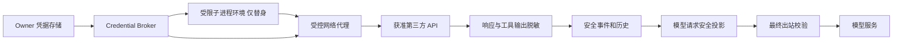

# Vega Credential Broker 设计方案

状态：用户于 2026-10-14 授权整体实现，执行事项 [#378](https://github.com/puzige/vega/issues/378)。本文为实现契约，分阶段仅表示内部执行顺序；按完整范围交付，真实隔离仍需用户手测。

目标是让 Agent 正常使用获准的 API 凭据，同时让模型、工具环境、对话历史和日志只接触替身或脱敏值。采用受信任的 Credential Broker 管理映射，在第三方请求的认证位置注入真实值；修复现有误报和历史恢复作为独立阶段，不等待网络代理完成。

## 1 现状与问题

源码基线：Vega `7759ff92`；本地 Codex 参考版本 `d583e73c4d1204f1e9f654ef87065e9f0dd07ac7`。版本固定用于复核，不代表已安装应用版本。

| 当前模块 | 已有行为 | 需要调整的地方 |
| --- | --- | --- |
| `vega_store::keystore` | 配置根下 owner-only 明文文件，`key_ref` 间接引用 | 保留存储契约；0700/0600 不能隔离同 UID 的工具进程 |
| `app_agent.rs` | 组合 Provider 与 MCP owner credential reader，包装模型 Provider | 将凭据读取、检测与工具使用授权分离；持有凭据不等于允许工具使用 |
| `credential_redaction.rs` | 精确值、转义值与通用格式检测，统一替换 marker | 返回有来源和类别的检测结果；已注册替身先识别；不再用宽泛猜测统一硬拦截 |
| `OwnerCredentialProvider` | 每次模型请求前扫描消息、推理、工具参数和工具定义；重试前重查 | 保留最终校验，但在校验前构建安全投影；绝不在模型正文里还原真实值 |
| runtime tool result | 结果进入事件、历史和后续上下文前脱敏 | 延续，补齐响应、流式输出和别名生命周期 |
| `redact_legacy_thread_content` | 清理历史助手正文、工具输出、摘要；发生变化就中止；不清理用户消息和工具参数 | 不再把“已清理”当成失败；保留用户原文的同时构建安全模型投影 |
| `CredentialExposureBlocked` | 无附加信息的错误，多个原因共用提示 | 拆分真实命中、疑似命中、读取不可用、授权与恢复失败 |
| `vega_tools::sandbox` | Seatbelt 默认允许，限制文件写；允许网络；Bash 继承环境并执行 `zsh -lc` | 不是秘密隔离边界，必须补齐受控环境、读取限制和出口约束 |

误报示例：`password: String::new()` 符合当前“字段名 + 冒号 + 值至少 8 字节”的规则；这是规则推导例子，不是截图事件的根因判定。截图只证明发生通用拦截，不能确定真实泄露、误报或凭据读取故障。

## 2 Codex 参考与采用范围

Codex `network-proxy/src/credential_broker.rs` 中的 `CredentialRecord` 保存真值、假值、目标绑定和 environment ID；`virtualize_child_env_for_environment` 虚拟化子进程环境；`inject_request_headers_for_environment` 按环境、目的地与请求头选择认证。`mitm.rs` 在 HTTPS 请求解析后调用凭据注入。`matching.rs` 还处理已知凭据的文本虚拟化。

对应测试覆盖：没有 dummy 不自动加入认证、不覆盖其他显式认证、环境隔离、目标不匹配和多凭据选择。源码提供此能力不意味着所有 Codex 模式默认开启。Codex 还存在通用 `restore_text` 能力；Vega 不将其作为任意命令或模型正文的还原入口。

OpenAI Vault 的公开文档同样描述：沙箱环境变量承载 placeholder，代理仅向允许的 HTTPS 主机替换认证头；需要本地密钥运算的签名操作由受信任工具承担。[Vault 官方文档](https://developers.openai.com/api/docs/guides/agents-api/tools/vaults)

采用：映射管理、环境虚拟化、目的地约束、认证位置注入、兼容客户端格式的替身。独立设计：Vega 权限模型、历史投影与恢复、误报复核、持久化格式和原生 UI。不得直接搬入 Codex 全套依赖；库选型、许可证与 TLS 方案在实现规格阶段单独评审。

## 3 安全目标与非目标

1. 真值只在 owner 凭据存储与受信任认证组件内使用，不进入模型请求正文、工具 schema、工具参数、普通事件或日志。
2. 工具拿到替身仍需已有工具权限与目标授权。网络连接许可和凭据注入许可分别判断，任何一个不满足都不能注入。
3. 真实值只在认证头等预先配置的位置注入，不全局替换 URL、请求 body、shell 文本、生成文件或模型输出。
4. 代理故障不降级为把真值交给子进程；已有显式认证不被另一账号静默覆盖。
5. 以防止意外暴露和受限 Agent 的读取/外传为目标，不承诺抵抗同用户的宿主恶意进程、管理员或已被攻陷的 Vega。
6. 凭据被正确隐藏不代表 API 操作安全。仓库删除、写入等操作仍受工具/业务权限约束。

“受保护执行”必须同时满足文件、进程、环境与出口隔离验证。Full access 可获得替身带来的便利，但不得标示为凭据不可读取；若任务要求强隔离，凭据工具应走独立受限执行环境或受信任操作接口。该选择不应暗中修改 Full access 的含义。

## 4 架构与边界



模型服务的 HTTP 认证由受信任 Provider 客户端注入，图中“安全投影”仅指请求正文。第三方工具认证与模型认证共用凭据管理基础设施，但权限和调用链分开。

| 层 | 拟承担的职责 |
| --- | --- |
| `vega_store` | 延续 key_ref 存储；保存无秘密的绑定配置、策略版本与恢复状态；后续新表需显式 migration |
| `vega_conversation` | 会话使用授权、Broker 生命周期协调、历史投影、恢复事务和结构化状态 |
| `vega_runtime` | 接收不暴露真值的 capability/脱敏接口；模型投影最终检查、工具结果过滤；不依赖 UI |
| `vega_tools` | 在 spawn 前装配隔离环境与代理配置，约束 read/grep/bash 等入口；不持有可枚举全部凭据的接口 |
| 新增 headless Broker/代理组件（边界提案） | owner 凭据解析、替身映射、目标校验、认证注入、连接与凭据代际管理；不依赖 GPUI |
| `vega` / `vega_ui` | 可信配置入口、按任务授权、就近错误恢复与来源定位 |

首期可先使用现有受信任 Provider/MCP HTTP 客户端，不为这类调用强制引入 MITM。任意 curl/SDK 的透明支持才需要本地代理、TLS 拦截与隔离配套。

## 5 凭据记录与生命周期

概念记录分为持久配置与运行态，不是最终 Rust API：

| 数据 | 保存位置与约束 |
| --- | --- |
| credential_id、key_ref、服务名称 | 持久配置；名称不得取自秘密值 |
| 允许 scheme/host/port、可选 path/method、认证头和格式 | 可信配置；不能由模型通过环境变量扩展 |
| session/environment ID、grant ID、凭据 generation、有效期 | Broker 运行态；授权可撤销；跨线程或环境不能借用 |
| real_value | Broker/受信任客户端内存，来源为 owner 存储；不可序列化、Debug、普通 clone 或进入日志 |
| dummy_value | 随机、与真值不同、无可推导真值的编码；按客户端需要保留格式；可见但仍限制日志传播与授权使用 |
| 历史别名引用 | 持久化无秘密的别名 ID 与来源关系；不保存映射真值，不赋予历史别名执行授权 |

创建流程：可信设置选择凭据和目标 → 会话授权 → 读取当前代际 → 生成环境专属替身 → 清理子进程环境后注入替身。禁止从模型给出的“疑似 secret 文本”自动注册新凭据。

撤销/轮换：新请求重新验证 generation 和授权；旧代际不能继续启动请求。已经发送的请求无法撤回。运行中的旧替身映射只能按显式生命周期保留，不能因轮换重新授予被撤销权限。停止会话关闭相关连接与租约。

重启：不得仅凭磁盘上的旧 dummy 恢复注入权限；根据 key_ref 和当前授权创建新映射，历史投影改用新别名或不可执行 marker。密钥缺失只阻塞需要该密钥的操作，不应阻止阅读历史和无关对话。历史脱敏不能仅依赖“现在仍保存的真值”：已清理值保持清理，旧未知秘密由高置信检测/用户复核处理，不承诺识别一切任意字符串。

内存释放应缩短真实值存活时间并评估清零类型，但不宣称普通 Rust String 自动清零，也不承诺操作系统内存取证不可恢复。

## 6 网络出口与执行环境

### 6.1 注入契约

仅在以下条件同时满足时注入：执行环境已认证；会话授权有效；请求目的地与绑定相符；指定认证位置包含该环境注册的 dummy；当前凭据可用。代理不提供给工具调用的“查询真值”接口。

目标校验使用规范化 HTTPS URL，校验主机、端口及路径边界；拒绝 userinfo、歧义路径等不安全形式。配置主机仍需遵守 DNS/IP 与本地网络访问策略。重新连接、每次请求和重定向均重新检查；跨目标不得携带已还原认证。首期可拒绝跨目标认证重定向，避免自动扩展权限。

仅启动回环端口不是隔离：其他本机进程仍可能访问。连接须关联不可伪造的执行环境租约，并校验 dummy 的环境范围；不接受任意调用者自报 environment ID。替身不免除已有操作许可。

HTTPS 需要在工具到代理一侧使用受控信任的临时 CA，代理验证上游证书；CA 私钥留在代理，信任只传给该执行环境，不修改全局系统证书。证书固定、无法配置代理的 SDK、QUIC、SSH 和非 HTTP 协议不在首期透明支持范围。TLS 与连接取消、限流、大小限制和流式响应须一起设计，不能仅做字符串替换。

### 6.2 Vega 必要配套

- spawn 使用受控环境集合，处理继承环境、变量别名与编码形式；阻止 shell 启动脚本重新加载真值。当前 `zsh -lc` 行为需要明确兼容策略，不只设置几个 proxy 变量。
- 受限进程不得读取 Vega 凭据目录及其可达别名，也不得通过其他进程接口读取 Broker。文件工具和子进程共同遵循凭据路径拒绝策略；不能只限制 Bash。
- 强制受保护工具出口经代理；设置 `HTTP_PROXY`/`HTTPS_PROXY` 只是客户端建议，单独不足以防止绕过。不得因客户端不支持代理就静默直连并交付真值。
- stdio MCP 子进程与任意本地工具需要分别纳入隔离验收；远程 MCP 由 Vega 受信任客户端认证。编辑器终端、外部插件和其他宿主执行路径不能自动宣称已覆盖。
- 代理响应、错误和工具输出都要精确过滤已知真值，防止远端回显；流式过滤须保留足够跨 chunk 匹配窗口。未知长度、压缩、二进制响应的覆盖范围显式定义，未覆盖路径不宣称完整防泄露。
- HMAC/私钥签名、客户端证书等操作通过受信任签名/请求接口完成。替身无法用于本地密钥运算，不用恢复整个脚本来兼容。

## 7 误报策略

检测与处置分离。检测结果至少包含类别、rule ID、来源类型、message/tool ID、字段路径和范围、置信级别、是否已修复；UI 与日志不携带匹配真值。错误只暴露可操作信息，不返回凭据片段。

| 类别 | 默认策略 | 恢复 |
| --- | --- | --- |
| 当前环境注册 dummy | 保留安全投影；只有授权出口可还原 | 过期时重新绑定，不按前缀当作泄露 |
| owner 已知真值 | 在进入模型上下文前替换为安全别名/marker；最终检查残留才阻断 | 自动安全转换后继续；转换不完整则定位具体来源 |
| 高置信未知凭据 | 在出站副本中脱敏；不能凭模式推定账户归属或授予调用能力 | 需要原文语义时就近复核，可标记测试值/误报 |
| 低置信疑似格式 | 不自动改写原文或整段阻断；可提供局部复核 | 规则结合语法位置、长度、格式与熵；明确这会接受一定漏报风险，需评审批准 |
| 凭据读取或安全检查不可用 | 独立错误；受影响请求停止 | 修复配置后重试；保留草稿和进度，不提示删除聊天 |

误报例外绑定检测规则、具体内容指纹和作用域，不使用“整个会话关闭安全检查”。内容变更、规则变更或从疑似变为 owner 精确命中时重审。指纹采用本地 keyed 摘要，避免持久化低熵秘密的可枚举裸 hash。真实凭据精确命中不能被“误报”例外绕过。

同形 dummy 可能满足通用格式规则，因此识别顺序必须是：可信映射中的 dummy → 真值精确匹配 → 高置信规则 → 低置信规则。模型自造的类似占位符不具有自动豁免权。格式保留与兼容性测试使用合成值。

## 8 历史对话恢复

### 8.1 两种数据用途

用户原文、原始工具调用记录和模型出站投影分离。不得为让下一次请求通过而偷偷改写用户原文或重新执行历史命令。既有已脱敏的助手/工具记录保持脱敏，不尝试恢复真值。

每次加载历史、压缩摘要或发起模型请求都经同一安全投影服务：覆盖 user/assistant/tool、tool input JSON、reasoning、summary、工具描述/schema 以及可进入模型的附件文本。图片或二进制不能宣称被文本扫描覆盖；原有附件策略继续适用。

结构化工具参数按解析后的字符串叶子转换再序列化，保持合法 JSON 和 tool-call 配对；系统/tool schema 不应被随意改写成无效定义，必要时禁用具体工具并提示修复配置。纯文本脚本的投影可脱敏，但历史调用参数的脱敏副本绝不直接当作待执行命令。

### 8.2 恢复状态机

```text
准备历史 → 读取版本与投影 → 检测
  ├─ 无命中 → 最终校验 → 请求
  ├─ 可安全转换 → 生成安全投影 → 最终校验 → 同一轮继续
  ├─ 需复核 → 定位来源 + 脱敏预览 → 用户处理 → 重新投影
  └─ 检查不可用 → 保留状态 → 修复配置 → 重新投影
```

去掉“发生过历史清理就必定失败”的语义。自动转换成功且不影响操作判断时，不弹永久成功条；详细转换记录按需查看。确实需要处理时展示“查看位置”“脱敏后继续”或“检查凭据设置”，按原因出现，不堆叠所有按钮。

以 source_version、投影策略版本、凭据 generation 和 grant 版本校验投影；并发编辑或轮换后重建，不能复用失效结果。最终校验仍在请求前及内部 HTTP 重试前执行；新代际发现残留时返回可恢复状态，不能以旧结果放行。

工具已执行但后续模型请求被阻断时，保存已完成工具结果和续跑游标，只重建下一次模型请求，不重放成功工具。未完成/结果未知的副作用单独显示，不能靠自动重试假定未执行。多次点击恢复使用幂等操作 ID；取消、崩溃或重启后恢复不得生成重复用户消息或重复写文件。

### 8.3 原始数据清理

安全投影解决继续对话，不等于清除磁盘原始敏感数据。默认保留用户原文的语义所有权，但展示时采用遮盖；需要永久清理时提供单独明确操作，预览受影响位置，原子更新记录/索引/摘要/offset 并失效投影缓存，不删除无关对话。

SQLite WAL、备份、导出与已写出的外部文件可能仍含旧值。数据库逻辑清理不能宣称物理擦除；不自动改写外部文件或删除用户备份。正文、工具详情、搜索、复制、导出和错误回显均纳入安全展示/投影检查，避免恢复聊天后从其他入口重新暴露。

## 9 用户可见行为

正常 API 调用不增加提示条。设置中按服务配置凭据与用途，首次使用按现有权限模型授权；已授权范围不重复确认。Full access 的保护边界在选择相关模式或凭据用途时说明，不在每条消息重复。

阻塞提示只说明事实、影响和下一步，例如“GitHub 凭据已失效，重新连接后继续”或“这条工具记录需要脱敏后才能继续”，并提供对应动作。来源定位展示消息/工具、字段与遮盖后的上下文，不显示 secret 前后缀。凭据详情、修复与误报操作可键盘访问；状态不只靠颜色表达。

命中已清理且能继续时直接继续；禁止再显示“请移除凭据”。“请求未发送”仅用于确认对应模型/API 请求未发出的情况，不能暗示此前工具操作也未执行。

## 10 分阶段落地与验收

| 阶段 | 交付边界 | 必须满足的退出条件 |
| --- | --- | --- |
| A 恢复与检测分离 | 类型化原因、安全投影、精确匹配与启发式分级、历史恢复 | 无重复工具副作用；可清理历史同轮继续；真实残留仍挡住；误报例子不再永久锁会话 |
| B 受信任客户端认证 | Broker 授权/代际接口，Provider 与远程 MCP 接入 | 模型正文无真值；认证只进入指定目标和位置；轮换、撤销和重启契约通过 |
| C 受限 Shell API 试点 | 单一受支持服务、子进程替身、HTTPS 代理和隔离 | 文件读取/环境/网络绕过均验证；不支持客户端明确失败，无真值回退 |
| D 扩展兼容 | 更多服务、stdio MCP、签名工具、复制/导出覆盖 | 每条新执行链独立验收；Full access 不沿用受限模式保证 |

测试使用合成凭据与进程内替身：真实/假值碰撞、短值边界、JSON 转义、分片输出、规则幂等、schema 有效性、多账号歧义、跨会话误用、目标/端口/路径/重定向变化、轮换撤销、读取失败、代理失败、过期别名、历史配对、摘要链、offset、并发版本冲突、崩溃恢复和重复点击。既有权限、工具配对及持久化断言继续保留。

云端 PR Check 运行自动化功能与回归测试；本地仅快速差异/格式/静态检查，不编译构建。真实 TLS、Seatbelt、SDK、进程读取边界与原生 UI 由用户手测并明确记录证据；mock 通过不得作为实际隔离成立的证据。C 阶段在真实隔离验收前仅称兼容性试点，不承诺完整保护。

## 11 实现决策

用户授权整体实施以下决策；A 至 D 是内部实现顺序，不是缩减交付范围：

1. 将低置信格式规则从硬拦截降为复核，接受其检测能力边界；真实 owner 命中仍强制处理。
2. 默认保留用户原始内容，以安全投影支持模型续跑；永久磁盘清理作为独立操作。
3. 受保护 Shell 使用受限执行环境；Full access 不承诺凭据不可读取，不静默提供真值回退。
4. 首期透明代理限定 HTTPS 请求头认证；签名和不兼容客户端走受信任操作接口。
5. 新增 headless `vega_credentials` crate。架构评审批准最小 TLS 依赖 `rustls`、`tokio-rustls`、`rcgen`（ring 后端）及 HTTP 解析所需依赖；优先复用 lock 既有版本的 `hyper`、`hyper-util`、`http-body-util`，`httparse` 仅在有严格 framing 契约时使用。版本必须精确锁定，不禁用上游证书验证。具体版本和使用理由记录在交付文档。
6. 首个可信配置入口使用 owner `config.toml` 的无秘密 `credential_bindings`，含 key_ref、环境变量、HTTPS 目标、认证头和可选路径约束。模型不能注册/修改授权；owner 配置与凭据文件都受工具访问保护。配置需有验证与可操作错误，不能仅实现无人调用的 Broker API。
7. 代理须拒绝冲突 Content-Length/Transfer-Encoding、重复长度、目标与 Host 不一致、歧义 URL、CRLF 和不支持的协议升级；请求/响应均有大小与时间上限。只绑定回环端口不足以认证工具，必须校验运行态环境租约。
8. 实施时冻结 Full access 边界：有凭据绑定的 Shell 调用要求切换受保护模式后执行，不在 Full access 隐式启动 Broker 租约。所有内置工具禁止读写 Vega owner 配置/凭据根；Full access 仅为内部资源保护施加最小限制，保留普通网络与项目外文件访问，不宣称强隔离。错误在相关操作位置说明切换方式。
9. 首版透明代理支持有界 HTTPS HTTP/1 头认证，响应缓冲过滤后返回，不宣称增量 SSE、任意编码或签名协议透明兼容。HMAC/私钥等需要专门受信任操作的场景明确拒绝，不向脚本恢复真值；本任务不创建没有业务契约的通用签名服务。

## 12 参考入口

- [现有工具输出与历史恢复契约](vega-tool-credential-redaction.md)
- [本地凭据存储契约](vega-r10-local-credentials.md)
- [Vega 凭据检测](../crates/vega_runtime/src/agent/credential_redaction.rs)
- [模型请求最终校验](../crates/vega_conversation/src/agent/credential_guard.rs)
- [历史清理实现](../crates/vega_store/src/context_compaction.rs)
- [工具执行隔离边界](../crates/vega_tools/src/sandbox.rs)
- Codex 固定版本：`codex-rs/network-proxy/src/credential_broker.rs`、`credential_broker/matching.rs`、`credential_broker/provider_config.rs`、`credential_broker_tests.rs`、`mitm.rs`；版本见第 1 节。
- [OpenAI Vault 凭据代理](https://developers.openai.com/api/docs/guides/agents-api/tools/vaults)

用户已授权按本方案整体实现：本方案替代旧规格的“清理后必定中止”和低置信格式统一硬拦截行为，保留精确秘密的出站保护与既有工具权限。
